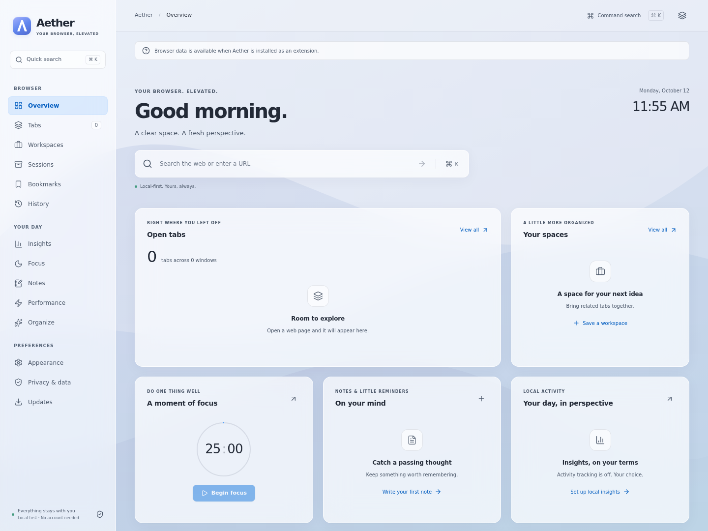
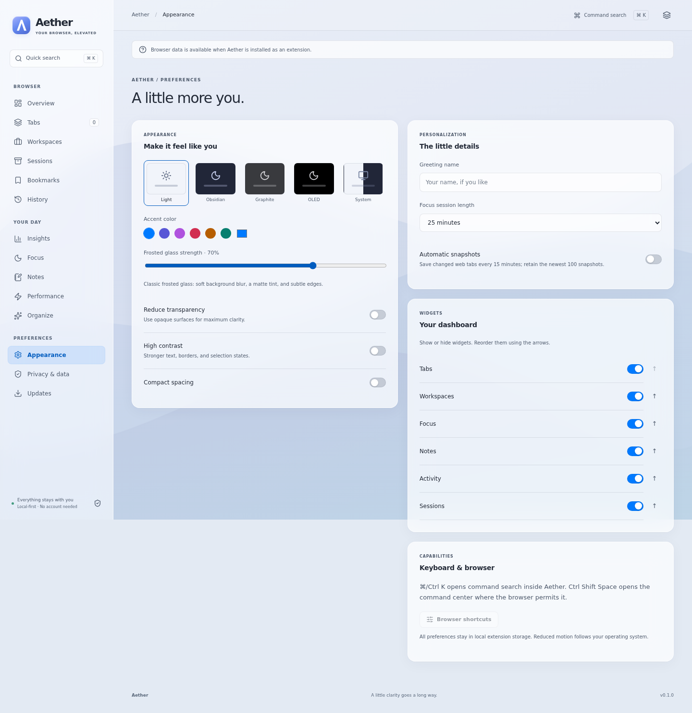

# Aether

### Your browser. Elevated.

A local-first Chromium extension that brings your tabs, saved spaces, focus, and notes into a calm command center. Its interface uses **classic frosted glass**: matte translucency, soft backdrop blur, fine borders, and restrained shadows. It does not use Liquid Glass, refraction, or animated reflective effects.



**Version 0.1.0 is an initial functional release.** The original product brief is a long-term roadmap, not a claim that every requested feature is complete. See [feature status and limitations](docs/STATUS.md) and [validation evidence](docs/TESTING.md).

[Download releases](https://github.com/Arnav-Dugad/Aether/releases) · [Install](docs/INSTALL.md) · [Privacy](PRIVACY.md) · [Architecture](docs/ARCHITECTURE.md)

## A quieter browser

- **Four connected surfaces:** new tab, toolbar popup, side panel, and full command center.
- **Tabs that work:** live cross-window lists, search, pin/unpin, close, duplicate review, and recently closed recovery.
- **A place for your work:** named workspace URL collections and session snapshots with selective, multi-window restoration. Private and internal pages are excluded.
- **Local productivity:** editable notes and checkoffs; durable focus timers with completed-session history.
- **Real insights:** optional domain-level foreground tracking and a seven-day activity chart. No fabricated activity or per-tab RAM claims.
- **Appearance, instantly:** Light, Obsidian, Graphite, OLED, and System themes; custom accents, glass strength, compact spacing, high contrast, and reduced transparency.
- **Your browser library:** bookmarks and recent history after an explicit browser permission request.
- **Transparent updates:** manual GitHub release checks, genuine release notes, and official package links.
- **Keep your data:** validated portable backup import/export, CSV activity export, permission revocation, and local deletion.



Screenshots show the real built UI served locally for layout verification. Browser-dependent features show truthful empty states in this mode; no fabricated browsing data is used.

## Install

1. Download `aether-chromium-v0.1.0.zip` from [Releases](https://github.com/Arnav-Dugad/Aether/releases).
2. Extract it to a permanent folder.
3. Open `chrome://extensions`, `edge://extensions`, or `brave://extensions`.
4. Enable **Developer mode**, choose **Load unpacked**, and select the extracted folder containing `manifest.json`.
5. Pin Aether to the toolbar and open a new tab.

The ZIP is an unpacked extension package. Aether is not currently published to a browser store. It cannot silently install or replace extension code. [Detailed installation and update guidance](docs/INSTALL.md).

## Keyboard

| Shortcut                   | Action                                           |
| -------------------------- | ------------------------------------------------ |
| Ctrl K / ⌘ K inside Aether | Open command search                              |
| Ctrl Shift Space           | Open command center, if supported and unassigned |
| ↑ / ↓ / Enter              | Navigate and execute command results             |
| Esc                        | Close an open dialog                             |

Configure the browser-level shortcut in your browser's extension shortcut settings.

## Develop

Requires Node.js 22.12+ or 24 and npm. Dependencies and the lockfile are committed; licenses are MIT/Apache-2.0/ISC/BSD family. No paid services are required.

```bash
npm ci
npm run dev
npm run check
npx playwright install --with-deps chromium
npm run test:e2e
npm run package
```

Load `.output/chrome-mv3` for the production build. `npm run package` creates a ZIP with `manifest.json` at its root, a release manifest, and SHA-256 checksums in `dist/`.

The GitHub workflow validates the code, runs full Chromium extension tests, and publishes a versioned release on successful main-branch builds when that version has not already been released. Existing releases are not replaced. Update the package and manifest versions together for a new release.

## Privacy and compatibility

No account, telemetry, advertising, remote scripts, or mandatory network requests. Data stays in IndexedDB and local extension storage. Activity recording is off by default. Optional GitHub requests disclose your IP to GitHub and retrieve public release metadata; browsing data is not sent.

Chrome/Edge/Brave/Vivaldi are targets, not blanket compatibility certifications. The side panel has a popup-window fallback when its API is unavailable, though browsers rejecting the `sidePanel` manifest permission may need a separate build. See the [compatibility matrix](docs/COMPATIBILITY.md).

## Contribute

Read [CONTRIBUTING.md](CONTRIBUTING.md), [SECURITY.md](SECURITY.md), and the [architecture](docs/ARCHITECTURE.md). Licensed under [MIT](LICENSE). Aether is an original project; it is not affiliated with Apple or any browser vendor.
